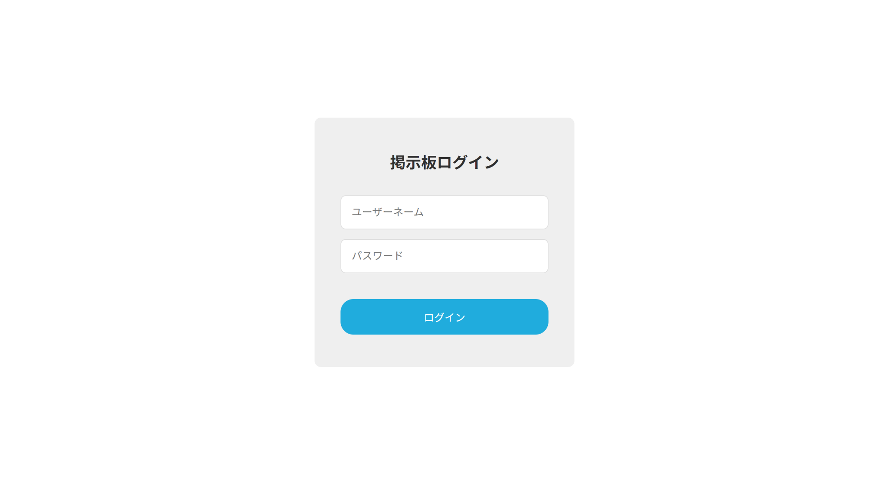
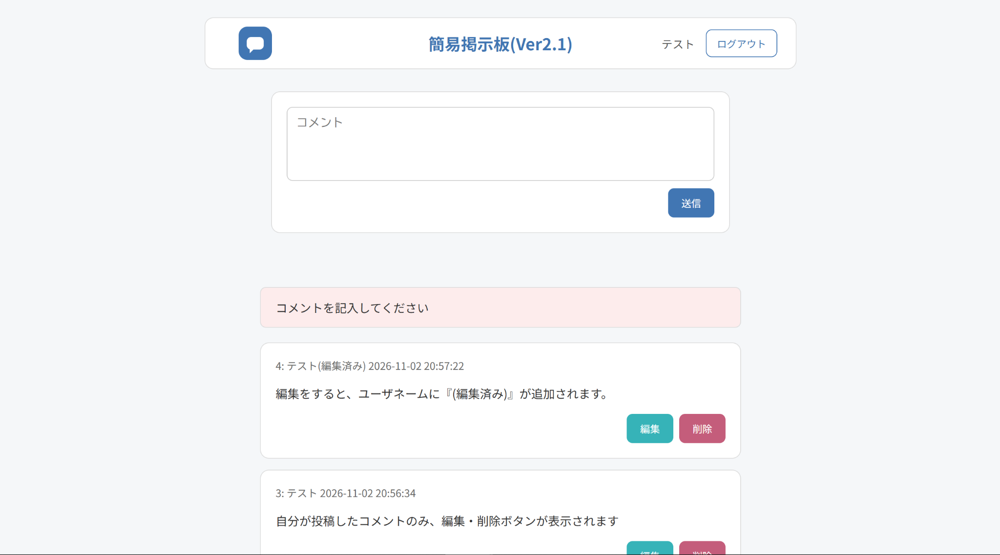

# PHP簡易掲示板

PHPとPostgreSQLを使用して制作した、ログイン機能付きの簡易掲示板です。ユーザー登録・ログインから投稿・編集・削除まで、Webアプリケーションの基本的な機能を実装しました。

## 画面イメージ

### ログイン画面



### 掲示板画面



## 制作概要

Webアプリケーションにおける、画面からの入力、PHPによるサーバー側の処理、データベースへの保存・取得、ログイン状態の管理を一通り学ぶことを目的として制作しました。

当初はMySQLを用いていましたが、後からPostgreSQLへ移行しました。また、Gitを利用して変更履歴を管理しています。

## 主な機能

- ユーザー登録・ログイン
  - 未登録のユーザー名の場合、新規登録を行います。
  - 登録済みユーザーはパスワードを照合してログインします。
- ログアウト
- 掲示板への投稿と、新しい投稿から順番に並ぶ一覧表示
- 自分の投稿の編集・削除
- 編集済み投稿への「編集済み」表示
- 未ログイン時の掲示板画面へのアクセス制限

## 使用技術

| 分類 | 技術 |
| --- | --- |
| バックエンド | PHP |
| データベース | PostgreSQL |
| データベース接続 | PDO（pdo_pgsql） |
| フロントエンド | HTML / CSS |
| バージョン管理 | Git / GitHub |
| 開発・動作確認 | VS Code / pgAdmin 4 / PHP組み込み開発サーバー |

## 実装上の工夫

- PDOのプリペアドステートメントとプレースホルダーを使い、ユーザー入力をSQL文に直接連結しないようにしました。
- パスワードは `password_hash()` でハッシュ化して保存し、`password_verify()` で照合しています。
- PHPセッションでログイン状態を管理しています。
- 投稿の編集では、SQLの `WHERE` 句でも投稿者のユーザーIDを照合しています。
- 投稿一覧の本文と投稿者名には `htmlspecialchars()` を使い、HTMLとして解釈されないようにしています。本文の改行には `nl2br()` を利用しています。
- データベース接続処理を `db.php` に分離し、パスワードは環境変数 `BOARD_DB_PASSWORD` から取得しています。

## ファイル構成

```text
PHP/
├── board_login.php          # ユーザー登録・ログイン
├── board_web.php            # 投稿の一覧表示・作成・編集・削除
├── db.php                   # PostgreSQLへの接続
├── images/                  # READMEで使用する画面画像
│   ├── login.png            # ログイン画面
│   └── board.png            # 掲示板画面
├── login_style.css          # ログイン画面のスタイル
├── simple_board_style.css   # 掲示板画面のスタイル
└── .gitignore               # 管理対象から除外するファイルの設定
```

## 動作環境について

本アプリはPHPとPostgreSQLを使用するため、GitHub上のソースコードだけでは動作しません。動作させるには、PHPの `pdo_pgsql` 拡張機能、PostgreSQLのデータベース・テーブル、接続用ロールの設定が必要です。

データベース接続用パスワードはソースコードに記載せず、環境変数 `BOARD_DB_PASSWORD` から取得する構成にしています。

## 今後の課題

- セキュリティの向上：認証・権限管理、入力値の検証、画面表示、エラー処理などを見直し、より安全に運用できるよう改善する。
- 公開環境への対応：サーバー環境に合わせた設定やデプロイ方法を整備する。
- 使いやすさの改善：操作時のメッセージ表示や画面構成をさらに分かりやすくする。

現在はローカル環境で主要機能の動作を確認した段階であり、一般公開に向けた検証・改善は今後の課題です。
